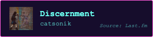

# lastfm-now-playing
> This project exposes the recently listened/currently playing track via Last.fm and returns the data.

One-click deploy to Cloudflare workers:

[](https://deploy.workers.cloudflare.com/?url=https://github.com/nabilridhwan/track)

# Required Environment Variables
In `wrangler.jsonc` or from your Cloudflare dashboard, make sure that both exists:
- `LAST_FM_API_KEY`
	- type: `secret`
    - description: LastFM API key
- `LAST_FM_USERNAME`
	- type: `plaintext`
    - description: LastFM username that you want to get the currently/recently played track of


# Usage

### GET `/`

Returns the currently playing or most recently played track. `isCurrentlyPlaying` indicates whether the track is playing now. `themes` maps each theme name to its SVG badge URL on the same host. If there are no recent tracks, the response is `{"track": null}`.

Example response from `http://localhost:8787/`:

```json
{
  "track": {
    "name": "Discernment",
    "artistName": "catsonik",
    "images": [
      {
        "size": "small",
        "#text": "https://lastfm-img.freetls.fastly.net/i/u/34s/8266f9d64e87be5b1adb4aad892b2c30.jpg"
      },
      {
        "size": "medium",
        "#text": "https://lastfm-img.freetls.fastly.net/i/u/64s/8266f9d64e87be5b1adb4aad892b2c30.jpg"
      },
      {
        "size": "large",
        "#text": "https://lastfm-img.freetls.fastly.net/i/u/174s/8266f9d64e87be5b1adb4aad892b2c30.jpg"
      },
      {
        "size": "extralarge",
        "#text": "https://lastfm-img.freetls.fastly.net/i/u/300x300/8266f9d64e87be5b1adb4aad892b2c30.jpg"
      }
    ],
    "isCurrentlyPlaying": false
  },
  "themes": {
    "default": "http://localhost:8787/?image=true&theme=default",
    "retro": "http://localhost:8787/?image=true&theme=retro",
    "cyberpunk": "http://localhost:8787/?image=true&theme=cyberpunk",
    "pink": "http://localhost:8787/?image=true&theme=pink",
    "red": "http://localhost:8787/?image=true&theme=red",
    "green": "http://localhost:8787/?image=true&theme=green",
    "blue": "http://localhost:8787/?image=true&theme=blue"
  }
}
```

### GET `/?image=true`

Returns the track as an SVG badge. Use `theme` to select a style, for example `/?image=true&theme=retro`. Omitting `theme` or passing an unrecognized value uses `default`.

| Theme | Screenshot |
| --- | --- |
| `default` |  |
| `retro` |  |
| `cyberpunk` |  |
| `pink` |  |
| `red` |  |
| `green` |  |
| `blue` |  |

# Local Development

1. With Node.js 22 or newer and pnpm installed, clone the repository and install the dependencies.

   ```sh
   git clone https://github.com/nabilridhwan/track.git
   cd track
   pnpm install
   ```

2. Get a [Last.fm API key](https://www.last.fm/api). Create a `.dev.vars` file in the project root, next to `wrangler.jsonc`, and add your key.

   ```dotenv
   LAST_FM_API_KEY="your-last-fm-api-key"
   ```

   If you already use a local `.env` file, put the key there instead. Both files are ignored by Git. Set `LAST_FM_USERNAME` under `vars` in `wrangler.jsonc` to the Last.fm username whose tracks you want to display. See [Wrangler's local environment setup](https://developers.cloudflare.com/workers/local-development/environment-variables/).

3. Start the local Worker.

   ```sh
   pnpm dev
   ```

4. Keep the dev server running and try the JSON and SVG endpoints in another terminal.

   ```sh
   curl http://localhost:8787/
   curl 'http://localhost:8787/?image=true&theme=retro'
   ```

   To preview the SVG, open [the retro badge](http://localhost:8787/?image=true&theme=retro) in a browser.
